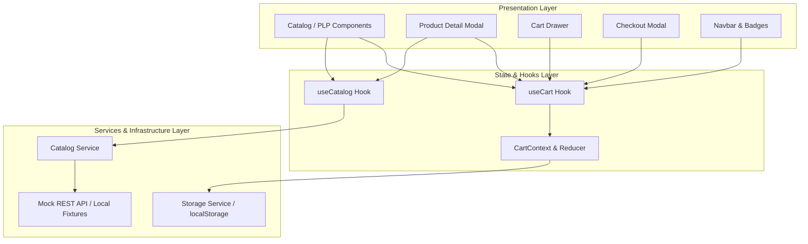

# Architecture Spine — E-Commerce Web Storefront

## 1. Design Paradigm

The system follows a **Component-Driven Layered Single Page Application (SPA)** architecture with strict **Unidirectional Data Flow**.



### Layer Responsibilities
- **Presentation Layer (`src/components/`)**: Pure view components and layout containers. Components receive data via props or domain hooks; direct network fetches or raw `localStorage` accesses are strictly prohibited.
- **State & Hooks Layer (`src/context/`, `src/hooks/`)**: Centralizes domain state, action dispatchers, and stateful business rules (cart calculations, debounced search filters).
- **Services & Data Layer (`src/services/`, `src/data/`)**: Isolates external data consumption, fixture ingestion, error handling, and serialization boundaries.

---

## 2. Invariants & Rules

### AD-1 — Single Source of Truth for Shopping Cart State [ADOPTED]
- **Binds:** FR-7, FR-8, FR-9, FR-10, UJ-2
- **Prevents:** Desynchronization of cart item counts and price calculations across Navbar, PDP, Cart Drawer, and Checkout Modal.
- **Rule:** All cart modifications (add item, update quantity, remove item, clear cart) must be dispatched through `CartContext` powered by a pure `cartReducer`. No local component-level cart state duplication is permitted.

### AD-2 — Storage Abstraction Barrier [ADOPTED]
- **Binds:** FR-10, FR-14
- **Prevents:** Direct, unhandled `window.localStorage` calls, runtime crashes in restricted environments (incognito/SSR), and corrupted JSON parsing states.
- **Rule:** All client storage access must pass through `storageService.js`. The service must wrap operations in `try/catch` safety blocks, provide in-memory fallback, and safely validate schema versions on reload.

### AD-3 — Decoupled Catalog Service Boundary [ADOPTED]
- **Binds:** FR-1, FR-2, FR-3, FR-4, FR-5, UJ-1
- **Prevents:** Tight coupling between React UI components and specific backend endpoints or fixture shapes.
- **Rule:** Catalog data ingestion is strictly encapsulated inside `catalogService.js`. The service normalizes raw external data (e.g. FakeStoreAPI, DummyJSON, or `products.json`) into the canonical `Product` interface before exposing it to custom hooks.

### AD-4 — Encapsulated Multi-Step Checkout State Machine
- **Binds:** FR-11, FR-12, FR-13, FR-14, UJ-3
- **Prevents:** Polluting global application state with ephemeral form data; premature cart erasure before checkout completion.
- **Rule:** The multi-step checkout workflow (Shipping $\rightarrow$ Payment $\rightarrow$ Review $\rightarrow$ Confirmation) is isolated within a dedicated modal state machine. Cart clearing (FR-14) is dispatched only upon atomic transition to the Order Confirmation state.

### AD-5 — Pure Composition for Search, Filter, and Sort
- **Binds:** FR-2, FR-3, FR-4
- **Prevents:** State collision where sorting resets category filters or search queries unexpectedly drop active sorting modes.
- **Rule:** Catalog filtering and sorting is implemented as a composable, pure function pipeline:
  $$\text{RenderedItems} = \text{Sort}(\text{FilterByCategory}(\text{FilterBySearch}(\text{Catalog}, \text{query}), \text{category}), \text{sortMode})$$

---

## 3. Consistency Conventions

| Concern | Convention | Enforced Rule |
|:---|:---|:---|
| **File & Component Naming** | `PascalCase` for React components; `camelCase` for hooks/services/utils | e.g. `ProductCard.jsx`, `useCart.js`, `catalogService.js` |
| **Monetary Formatting** | Centralized formatter | Never format currency with string interpolation inline; use `formatCurrency(amount)` producing `$XX.XX` |
| **Identifiers** | String IDs | Product IDs and Order IDs are treated as strings (`id: "1"`, `orderId: "ORD-78421"`) |
| **Asynchronous State** | Standardized status tuples | `useCatalog` must expose `{ data, isLoading, error, refetch }` |
| **State Immutability** | Pure Reducer actions | Reducer actions must return fresh object copies (`{ ...state, items: [...] }`) with zero in-place mutations |

---

## 4. Technology Stack (Seed)

| Component / Layer | Pinned Version / Technology | Role |
|:---|:---|:---|
| **Core Framework** | React `^19.3.1` | UI Component rendering with React Compiler optimization |
| **Build & Dev Tooling** | Vite `^8.3.6` | Development server and production bundling |
| **State Management** | React Context + `useReducer` | Global reactive Cart state without heavy external state libraries |
| **Styling** | Modern CSS / CSS Modules | Modular responsive styling with CSS variables for design tokens |
| **Icons / UI Accents** | Lucide-React or clean inline SVGs | Lightweight SVG icons for cart, search, trash, and star ratings |

---

## 5. Structural Seed & Directory Layout

```text
src/
├── assets/                  # Static assets and icons
├── components/
│   ├── common/              # Shared UI primitives
│   │   ├── Navbar.jsx       # Header with branding and Cart toggle button
│   │   ├── Badge.jsx        # Pill badges for categories and cart count
│   │   ├── Button.jsx       # Standardized primary/secondary buttons
│   │   └── Toast.jsx        # Lightweight transient notifications
│   ├── catalog/             # Catalog discovery domain
│   │   ├── ProductGrid.jsx  # Responsive grid container with loading skeletons
│   │   ├── ProductCard.jsx  # Individual item card with image and quick add
│   │   ├── SearchBar.jsx    # Debounced keyword search input
│   │   ├── CategoryPills.jsx# Interactive category filter tabs
│   │   └── SortDropdown.jsx # Price & rating sort selection
│   ├── detail/              # Inspection domain
│   │   └── ProductDetailModal.jsx # Expanded modal view with full specs and quantity
│   ├── cart/                # Cart management domain
│   │   ├── CartDrawer.jsx   # Slide-over cart drawer container
│   │   └── CartItem.jsx     # Line item row with quantity (+/-) and remove buttons
│   └── checkout/            # Checkout domain
│       ├── CheckoutModal.jsx# Wizard coordinator
│       ├── ShippingStep.jsx # Address & contact form with validation
│       ├── PaymentStep.jsx  # Mock payment selector
│       ├── ReviewStep.jsx   # Final summary & Place Order action
│       └── OrderSuccess.jsx # Confirmation receipt and Order ID
├── context/
│   ├── CartContext.jsx      # Provider and CartContext definition
│   └── cartReducer.js       # Pure state reducer for cart mutations
├── hooks/
│   ├── useCart.js           # Consumer hook exposing cart state and actions
│   ├── useCatalog.js        # Catalog fetching, filtering, and sorting hook
│   └── useDebounce.js       # Utility hook for search input debouncing
├── services/
│   ├── catalogService.js    # Data retrieval and normalization
│   └── storageService.js    # Resilient localStorage wrapper
├── data/
│   └── products.json        # Bundled mock dataset (20 items across categories)
├── utils/
│   └── formatters.js        # Currency, date, and order ID formatters
├── App.jsx                  # Root layout composing Catalog, Drawer, and Modals
├── index.css                # Global styles and responsive design tokens
└── main.jsx                 # Application entry point mounting CartProvider
```

---

## 6. Capability $\rightarrow$ Architecture Map

| Capability / Requirement | Lives In | Governed By |
|:---|:---|:---|
| **FR-1: Catalog Rendering** | `components/catalog/ProductGrid.jsx` | AD-3 (Decoupled Catalog Service) |
| **FR-2: Category Filtering** | `components/catalog/CategoryPills.jsx` | AD-5 (Pure Composition Pipeline) |
| **FR-3: Keyword Search** | `components/catalog/SearchBar.jsx`, `hooks/useDebounce.js` | AD-5 (Pure Composition Pipeline) |
| **FR-4: Price/Rating Sort** | `components/catalog/SortDropdown.jsx` | AD-5 (Pure Composition Pipeline) |
| **FR-5, FR-6: Product Detail & Quantity** | `components/detail/ProductDetailModal.jsx` | AD-3, Layer Separation |
| **FR-7 – FR-9: Cart Operations** | `components/cart/`, `context/cartReducer.js` | AD-1 (Single Source of Truth) |
| **FR-10: Cart Local Persistence** | `services/storageService.js`, `context/CartContext.jsx` | AD-2 (Storage Abstraction) |
| **FR-11 – FR-13: Simulated Checkout Wizard** | `components/checkout/` | AD-4 (Isolated Checkout State Machine) |
| **FR-14: Post-Checkout Cart Reset** | `context/cartReducer.js` (`CLEAR_CART` action) | AD-1, AD-4 |

---

## 7. Deferred Decisions

1. **Remote Database & Serverless Backend**: Deferred to V2. The current architecture strictly decouples `catalogService.js` so swapping local mock fixtures for a remote REST/GraphQL API requires changes to only one file.
2. **Third-Party Payment SDK (Stripe Elements / PayPal)**: Deferred to V2. The checkout architecture cleanly separates the Payment step, allowing easy injection of Stripe `<PaymentElement />` in the future.
3. **Server-Side Rendering (SSR) / Next.js Migration**: Deferred to V2/V3. The current SPA architecture provides optimal speed for MVP development while maintaining strict separation of concern.
