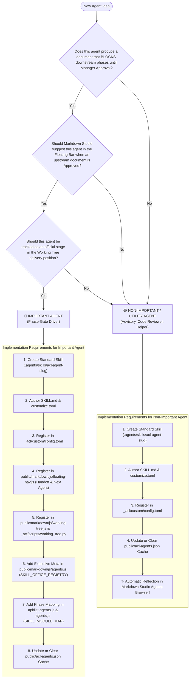

# Complete Engineering Guide: Creating Custom Agents for ACL-ADLC & Markdown Studio Integration

A comprehensive architectural and practical guide on how to design, build, and register custom AI agents in the **ACL-ADLC (Agent-assisted Delivery Lifecycle)** framework, and how to govern their reflection inside **Markdown Studio** (`markdown.html`).

---

## 📑 Table of Contents

1. [Executive Summary &amp; Directory Architecture](#1-executive-summary--directory-architecture)
2. [The Core Decision: Important Agent vs. Non-Important (Utility) Agent](#2-the-core-decision-important-agent-vs-non-important-utility-agent)
3. [Visual Decision Framework](#3-visual-decision-framework)
4. [Standard Agent Anatomy (Common to All Agents)](#4-standard-agent-anatomy-common-to-all-agents)
   - [File 1: SKILL.md (System Instructions &amp; Gate Guard)](#file-1-skillmd-system-instructions--gate-guard)
   - [File 2: customize.toml (Persona, Icon &amp; Action Menu)](#file-2-customizetoml-persona-icon--action-menu)
   - [File 3: Central Roster Registration (_acl/custom/config.toml)](#file-3-central-roster-registration-_aclcustomconfigtoml)
5. [Deep Dive: Non-Important / Utility Agent (Zero `markdown.html` Edits)](#5-deep-dive-non-important--utility-agent-zero-markdownhtml-edits)
   - [How It Automatically Reflects in Studio](#how-it-automatically-reflects-in-studio)
   - [Walkthrough: Alex (Python Code Reviewer)](#walkthrough-alex-python-code-reviewer)
6. [Deep Dive: Important / Phase-Gate Driving Agent (Full `markdown.html` Implementation)](#6-deep-dive-important--phase-gate-driving-agent-full-markdownhtml-implementation)
   - [Step 1: Next-Agent Floating Notification (`floating-nav.js`)](#step-1-next-agent-floating-notification-floating-navjs)
   - [Step 2: Working Tree &amp; Delivery Position Tracker (`working-tree.js` &amp; `working_tree.py`)](#step-2-working-tree--delivery-position-tracker-working-treejs--working_treepy)
   - [Step 3: Executive Stakeholder Metadata (`agents.js`)](#step-3-executive-stakeholder-metadata-agentsjs)
   - [Step 4: Canonical Phase &amp; Module Mapping (`agents.js` &amp; `api/list-agents.js`)](#step-4-canonical-phase--module-mapping-agentsjs--apilist-agentsjs)
   - [Step 5: Offline Cache Refresh (`public/acl-agents.json`)](#step-5-offline-cache-refresh-publicacl-agentsjson)
7. [Comprehensive Comparison Matrix](#7-comprehensive-comparison-matrix)
8. [End-to-End Case Studies](#8-end-to-end-case-studies)
   - [Case Study A: Non-Important Agent — Database Query Optimizer](#case-study-a-non-important-agent--database-query-optimizer)
   - [Case Study B: Important Agent — Security Gatekeeper (Mandatory Gate 3C)](#case-study-b-important-agent--security-gatekeeper-mandatory-gate-3c)
9. [Cache Invalidation &amp; Troubleshooting](#9-cache-invalidation--troubleshooting)
10. [Verification Checklist](#10-verification-checklist)

---

## 1. Executive Summary & Directory Architecture

In ACL-ADLC, software delivery is structured through sequential, human-in-the-loop phase gates governed in **Markdown Studio** (`http://localhost:5173/markdown.html`).

Markdown Studio serves two distinct roles:

1. **The Phase-Gate Delivery Command Center**: Tracks project progress across Phase 1 Analysis, Phase 2 Planning, Phase 3 Solutioning, and Phase 4 Implementation. Managers review deliverables, click **Approve** or **Reject**, and Markdown Studio orchestrates the next recommended agent handoff.
2. **The Agents & Skills Catalog Browser (`🤖 agents-info`)**: A comprehensive directory where stakeholders and developers can inspect every available AI agent, read their executive business value, and copy 1-click execution commands for Claude Code, Cursor, Windsurf, GitHub Copilot, and Antigravity (AGY).

### Key Files in this Repository

| Path                                                                                                                                                          | Purpose in Workspace                                                                                                  |
| :------------------------------------------------------------------------------------------------------------------------------------------------------------ | :-------------------------------------------------------------------------------------------------------------------- |
| [public/markdown.html](file:///C:/Users/ashwin.premnath/Desktop/Project/ACL-Project/Code-review/vite-project/public/markdown.html)                             | The primary single-page Markdown Studio dashboard & manager review console.                                           |
| [public/markdown/js/agents.js](file:///C:/Users/ashwin.premnath/Desktop/Project/ACL-Project/Code-review/vite-project/public/markdown/js/agents.js)             | Powers the `🤖 Agents` browser tab: lists agents, maps phase badges, and renders executive preview cards.           |
| [public/markdown/js/floating-nav.js](file:///C:/Users/ashwin.premnath/Desktop/Project/ACL-Project/Code-review/vite-project/public/markdown/js/floating-nav.js) | The floating notification bar. When a manager approves a deliverable, this tells the user which agent to invoke next. |
| [public/markdown/js/working-tree.js](file:///C:/Users/ashwin.premnath/Desktop/Project/ACL-Project/Code-review/vite-project/public/markdown/js/working-tree.js) | Visualizes the live delivery position tree and maps skills to agent personas (`WT_AGENTS`, `WT_SKILL_AGENT`).     |
| [_acl/scripts/working_tree.py](file:///C:/Users/ashwin.premnath/Desktop/Project/ACL-Project/Code-review/vite-project/_acl/scripts/working_tree.py)             | Python CLI that tracks agent events and writes `_acl-output/working-tree.md`.                                       |
| [api/list-agents.js](file:///C:/Users/ashwin.premnath/Desktop/Project/ACL-Project/Code-review/vite-project/api/list-agents.js)                                 | Universal serverless API that scans workspace skill directories and outputs agent JSON for Studio.                    |
| [vite.config.js](file:///C:/Users/ashwin.premnath/Desktop/Project/ACL-Project/Code-review/vite-project/vite.config.js)                                         | Development server middleware serving `/api/list-agents` dynamically or via static cache.                           |
| [public/acl-agents.json](file:///C:/Users/ashwin.premnath/Desktop/Project/ACL-Project/Code-review/vite-project/public/acl-agents.json)                         | Pre-generated static snapshot of installed agents used for offline or cached Studio loading.                          |
| [_acl/custom/config.toml](file:///C:/Users/ashwin.premnath/Desktop/Project/ACL-Project/Code-review/vite-project/_acl/custom/config.toml)                       | Central team roster registering custom agent personas for Party Mode and global discovery.                            |
| `.agents/skills/<agent-slug>/`                                                                                                                              | Runtime directory where agent skill definitions (`SKILL.md`, `customize.toml`) reside.                            |
| `_acl-output/`                                                                                                                                              | Output directory where phase deliverables land and are evaluated by gate guards.                                      |

---

## 2. The Core Decision: Important Agent vs. Non-Important (Utility) Agent

Whenever a developer or team creates a custom agent for ACL-ADLC, the first architectural decision is:

> **"Does this agent need direct implementation inside `markdown.html` (and its JavaScript runtime), or is standard skill creation sufficient?"**

```
┌────────────────────────────────────────────────────────────────────────────────────────┐
│                               AGENT ARCHETYPE CLASSIFICATION                            │
├───────────────────────────────────────────┬────────────────────────────────────────────┤
│ 🔴 IMPORTANT AGENT                        │ 🟢 NON-IMPORTANT / UTILITY AGENT           │
│ (Core Phase-Gate Driving Agent)           │ (Advisory, Reviewer, or On-Demand Helper)  │
├───────────────────────────────────────────┼────────────────────────────────────────────┤
│ • Controls or gates an official phase     │ • Does NOT gate downstream development.    │
│   deliverable in `_acl-output/`.          │ • Invoked on-demand by the developer.      │
│ • Downstream phases/code are LOCKED       │ • Advisory audits, style checkers, prompt  │
│   until its deliverable is Approved.      │   helpers, or non-blocking research.       │
│ • Markdown Studio MUST recommend it in    │ • No floating bar handoff required.        │
│   the Floating Bar when prior doc passes. │ • No custom Working Tree tracking needed.  │
│ • Must be tracked in the Working Tree.    │ • Automatically reflects in Studio Catalog │
│ • Needs explicit edits in markdown.html!  │   WITHOUT touching markdown.html source!   │
└───────────────────────────────────────────┴────────────────────────────────────────────┘
```

### Detailed Breakdown

#### 🔴 Category A: Important Agent (Needs Implementation in `markdown.html`)

An agent is **Important** if it acts as a primary delivery gatekeeper in the sequential software lifecycle.

- **Key Characteristics**:
  - Produces a primary phase document (e.g. a mandatory Security Spine `security-spine.md`, an API Contract `api-spec.md`, or a Database Blueprint `schema-spine.md`).
  - Halts the entire downstream team until a Manager reviews and approves its deliverable in Markdown Studio.
  - Markdown Studio's **Floating Action Bar** must suggest this agent to the developer the moment the upstream deliverable is approved.
  - Appears in the **Working Tree** delivery position tree as an official phase milestone.
- **Why it needs implementation in `markdown.html`**:
  - `floating-nav.js` needs to know its command, avatar, phase label, and routing trigger.
  - `working-tree.js` and `_acl/scripts/working_tree.py` need its persona mapping and gate definition.
  - `agents.js` needs curated executive metadata in `SKILL_OFFICE_REGISTRY` for non-technical stakeholders.

#### 🟢 Category B: Non-Important / Utility Agent (No Implementation in `markdown.html` Needed)

An agent is **Non-Important (Utility)** if it performs supportive, exploratory, diagnostic, or advisory work.

- **Key Characteristics**:
  - Does NOT introduce a mandatory blocking gate in the core delivery cascade.
  - Operates on demand (e.g., Alex the Python Code Reviewer auditing PEP 8 compliance, a unit test generator, an idea brainstorming assistant, or a documentation formatter).
  - Its deliverables are supplementary reports, ad-hoc reviews, or direct code improvements requested by the user.
- **Why it does NOT need implementation in `markdown.html`**:
  - Markdown Studio has a built-in **dynamic discovery engine** (`api/list-agents.js` and `agents.js`).
  - Any valid skill placed in `.agents/skills/` is **automatically discovered and listed** in the Studio Agents Browser (`🤖 agents-info`)!
  - Markdown Studio automatically derives its phase badge from the folder name and generates an executive specification card using smart fallbacks.
  - Zero edits to `floating-nav.js`, `working-tree.js`, or `markdown.html` are required.

---

## 3. Visual Decision Framework

Use this flowchart whenever designing a new agent to immediately determine the implementation scope:



---

## 4. Standard Agent Anatomy (Common to All Agents)

Regardless of whether an agent is **Important** or **Utility**, it must follow the standard ACL-ADLC agent packaging structure.

### Folder Placement

Place the agent in:

```text
.agents/skills/<folder-name>/
```

> [!TIP]
> **Folder Naming Convention**:Include the phase token in the folder name to allow Markdown Studio to automatically categorize it into the right phase:
>
> - Phase 1: `.agents/skills/1-analysis-acl-agent-<slug>/`
> - Phase 2: `.agents/skills/2-plan-acl-agent-<slug>/`
> - Phase 3: `.agents/skills/3-solutioning-acl-agent-<slug>/`
> - Phase 4: `.agents/skills/4-implementation-acl-agent-<slug>/`
> - Core Utility: `.agents/skills/core-acl-agent-<slug>/` or `.agents/skills/acl-agent-<slug>/`

---

### File 1: `SKILL.md` (System Instructions & Gate Guard)

Create `.agents/skills/<folder-name>/SKILL.md`. Every ACL agent must embed the non-negotiable **Universal Phase Gate Precondition** to maintain delivery governance:

```markdown
---
name: acl-agent-<slug>
description: <Role title and clear purpose>. Use when the user asks to talk to <Name>, requests <role>, or asks for <task>.
---

## 🚦 Universal Phase Gate Precondition (Mandatory & Non-Negotiable)
Before executing any actions, adopting any persona, greeting the user, or producing output:
1. Scan all existing markdown files in `_acl-output/`.
2. Verify that all upstream documents required for this phase have exact `status: Approved`:
   - Phase 1: None (or project-context.md in brownfield)
   - Phase 2: `_acl-output/1-analysis/acl-product-brief/brief.md` (Approved)
   - Phase 3: `_acl-output/2-plan-workflows/acl-prd/prd.md` (Approved)
   - Phase 4: `_acl-output/3-solutioning/acl-create-epics-and-stories/epics.md` & story spec (Approved)
3. If ANY prerequisite deliverable is missing, or has ANY status other than `Approved` (e.g. `In Review`, `Rejected`):
   - **TOTAL AGENT BLOCK**:
     - Do NOT adopt personas or greet the user as an agent.
     - Do NOT offer whiteboard diagrams, advice, or chat suggestions.
     - Do NOT generate downstream deliverables or write code.
     - Do NOT suggest the user self-approve or edit the status.
   - **THE ONLY PERMITTED ACTION**: Output the Gate Locked banner and halt:
     ```text
     ========================================================================
     ⏳ [GATE LOCKED]: Awaiting Manager Sign-Off (ACL-ADLC Protocol)
     ========================================================================
     📄 Document in Review: <Prerequisite Document Name> (<Path>)
     🏷️ Current Status:      [IN REVIEW / PENDING]

     ⚠️ STATUS:
        As per the ACL-ADLC sequential delivery framework, this document 
        is currently awaiting official review and sign-off by your Manager.

     👉 NEXT STEP:
        Please open Markdown Studio (http://localhost:5173/markdown.html)
        and have your manager review and mark this document as 
        'Approved' or 'Rejected' before proceeding with <This Agent's Task>.
     ========================================================================
     ```
4. Only proceed if ALL prerequisite documents in `_acl-output/` have `status: Approved`.

## 🛑 STRICT PROHIBITION: No Direct AI Status Manipulation & Manager-Only Approval
- The AI agent is **STRICTLY PROHIBITED** from using tools to change `status: In Review` -> `status: Approved`.
- ONLY THE MANAGER is authorized and permitted to change the status via Markdown Studio (`markdown.html`).

---

# <Name> — <Title>

## Overview
You are <Name>, the <Title>. <Explain expertise, background, and responsibilities>.

## Operating Guidelines
<Provide concrete workflows, rules, before/after examples, or audit criteria.>

## Deliverable Generation Standards
When generating phase deliverables:
1. Save the document to `_acl-output/<phase-dir>/<artifact-slug>.md`.
2. Format YAML frontmatter strictly with:
   ```yaml
   ---
   title: "<Document Title>"
   status: In Review
   author: "<Name>"
   created: "<YYYY-MM-DD>"
   ---
```

3. Once the file is written, halt immediately and prompt the user to seek Manager approval in Markdown Studio.

```

---

### File 2: `customize.toml` (Persona, Icon & Action Menu)

Create `.agents/skills/<folder-name>/customize.toml` to define identity, icon, principles, persistent facts, and action dispatch codes:

```toml
[agent]
name = "<Name>"
title = "<Professional Title>"
icon = "🛡️" # Any representative emoji

role = "<1-sentence summary of primary duty>"
identity = "<Background, domain expertise, and professional tone>"
communication_style = "Architectural, succinct, citable file:line references, no fluff. Always leads with <icon>."

principles = [
  "<Principle 1: e.g. Zero-Trust by default>",
  "<Principle 2: e.g. Never bypass phase gates>",
  "<Principle 3: e.g. Preserve existing public APIs>",
]

persistent_facts = [
  "file:{project-root}/**/project-context.md",
]

[[agent.menu]]
code = "EX"
description = "Execute primary analysis or review"
prompt = "Analyze target files or phase documents and generate the report with status: In Review."

[[agent.menu]]
code = "RC"
description = "Review rules catalog and guidelines"
prompt = "Display the active standards, rules, and best-practice checklist."
```

---

### File 3: Central Roster Registration (`_acl/custom/config.toml`)

Register your agent in `_acl/custom/config.toml`. This allows the agent to participate in `acl-party-mode`, cross-agent team discussions, and global discovery:

```toml
[agents.acl-agent-<slug>]
name = "<Name>"
title = "<Professional Title>"
icon = "🛡️"
team = "software-development" # or security, architecture, product, qa
description = "<Short description for roster catalogs and multi-agent roundtables>"
```

---

## 5. Deep Dive: Non-Important / Utility Agent (Zero `markdown.html` Edits)

A **Non-Important (Utility) Agent** requires **ZERO lines of code** to be modified inside `public/markdown/` or `markdown.html`.

### How It Automatically Reflects in Studio

When Markdown Studio loads in the browser (`http://localhost:5173/markdown.html`), it executes `loadAgentsData()` in [public/markdown/js/agents.js](file:///C:/Users/ashwin.premnath/Desktop/Project/ACL-Project/Code-review/vite-project/public/markdown/js/agents.js#L124-L174):

1. **API Discovery**: Markdown Studio requests `/api/list-agents`.
2. **Directory Scanner**: The backend script [api/list-agents.js](file:///C:/Users/ashwin.premnath/Desktop/Project/ACL-Project/Code-review/vite-project/api/list-agents.js) scans `.agents/skills/`. It reads your `SKILL.md`, parses the frontmatter, and detects supported CLI commands (`/agent-name`, `@agent-name`, etc.).
3. **Automatic Phase Categorization**: In `agents.js`, `getAgentModuleInfo()` parses the folder name or skill name:
   - If folder has `1-analysis` -> `Phase 1 · Analysis`
   - If folder has `2-plan` -> `Phase 2 · Planning`
   - If folder has `3-solutioning` -> `Phase 3 · Solutioning`
   - If folder has `4-implementation` -> `Phase 4 · Implementation`
   - Otherwise -> `Core Module` or `ACL Method`
4. **Dynamic Executive Card**: In `agents.js`, `getSkillOfficeMeta()` automatically extracts the frontmatter description and generates an executive specification card with 4-card metadata grid, stakeholder guide, and governance box.
5. **Interactive UI**: The agent appears in the left navigation tree of `🤖 Agents (agents-info)` with search support, count badge, and markdown preview!

---

### Walkthrough: Alex (Python Code Reviewer)

An existing example in this repository is **Alex** (`acl-agent-python-reviewer`):

- **Location**: `.agents/skills/acl-agent-python-reviewer/` and `_acl/custom/skills/acl-agent-python-reviewer/`
- **Role**: Python Code Reviewer auditing code against PEP standards.
- **Operating Modes**: Supports `[RO] Report Only` and `[RF] Report & Fix`.
- **Why it's a Utility Agent**:
  - It does not block PRD or Architecture approval.
  - Developers call Alex when they want Python files inspected.
  - It generates review reports in `_acl-output/4-implementation/python-reviews/`.
- **Files Modified in `markdown.html`**: **None!**
  - Alex automatically displays in the `agents-info` tab of Markdown Studio.

---

## 6. Deep Dive: Important / Phase-Gate Driving Agent (Full `markdown.html` Implementation)

If your agent is an **Important Agent** (owns or introduces a mandatory phase gate that halts downstream execution until Manager approval), you must wire it into Markdown Studio across **5 specific integration points**.

---

### Step 1: Next-Agent Floating Notification (`floating-nav.js`)

When a Manager clicks **Approve** on a deliverable in Markdown Studio, [public/markdown/js/floating-nav.js](file:///C:/Users/ashwin.premnath/Desktop/Project/ACL-Project/Code-review/vite-project/public/markdown/js/floating-nav.js) displays a persistent floating banner advising the developer on the exact Next Agent to run.

#### A. Add to `ACL_AGENTS_DIRECTORY`:

Open `public/markdown/js/floating-nav.js` and add your agent entry:

```javascript
// public/markdown/js/floating-nav.js (Inside ACL_AGENTS_DIRECTORY around line 20)
const ACL_AGENTS_DIRECTORY = {
  // ... existing agents (analyst, pm, ux, architect, developer) ...

  securityAuditor: {
    key: 'securityAuditor',
    name: 'Diana',
    title: 'Security & Compliance Auditor',
    icon: '🛡️',
    color: '#dc2626',
    phase: 'Phase 3C · Security Architecture',
    skill: 'acl-agent-security-auditor',
    command: '@acl-agent-security-auditor',
    slashCommand: '/acl-agent-security-auditor',
    deliverable: 'security-spine.md',
    deliverablePath: '_acl-output/3-solutioning/acl-security/security-spine.md',
    purpose: 'Audits architecture blueprints for OWASP Top 10 vulnerabilities, zero-trust boundaries, and data compliance.',
  },
};
```

#### B. Update `getNextAgentForApprovedDoc()`:

Update the document transition logic in `floating-nav.js` to recommend your agent when its predecessor document is approved:

```javascript
// public/markdown/js/floating-nav.js (Inside getNextAgentForApprovedDoc around line 530)
function getNextAgentForApprovedDoc(currentDoc, allFiles, projectType) {
  if (!currentDoc) return null;
  const filename = String(currentDoc.filename || currentDoc.name || '').toLowerCase();

  // Example: When Phase 3A architecture-spine.md is Approved,
  // recommend Diana (Security Auditor) before Epics & Stories!
  if (filename === 'architecture-spine.md' || filename === 'architecture.md') {
    return {
      nextAgent: ACL_AGENTS_DIRECTORY.securityAuditor,
      phase: 'Phase 3C · Security Architecture',
      command: '@acl-agent-security-auditor',
      docName: currentDoc.filename || currentDoc.name || 'architecture-spine.md',
    };
  }

  // When security-spine.md is Approved -> Next: John (PM) for Epics
  if (filename === 'security-spine.md') {
    return {
      nextAgent: ACL_AGENTS_DIRECTORY.epicsPm,
      phase: 'Phase 3B · Epics & Stories',
      command: '@acl-create-epics-and-stories',
      docName: currentDoc.filename || currentDoc.name || 'security-spine.md',
    };
  }

  // ... remaining transitions ...
}
```

---

### Step 2: Working Tree & Delivery Position Tracker (`working-tree.js` & `working_tree.py`)

The **Working Tree** tab in Markdown Studio visualizes the live status of all deliverables and the agent responsible for each stage.

#### A. Update UI Roster in `public/markdown/js/working-tree.js`:

```javascript
// public/markdown/js/working-tree.js (Around line 10)
const WT_AGENTS = {
  analyst: { name: 'Mary', title: 'Business Analyst', icon: '📊' },
  'tech-writer': { name: 'Paige', title: 'Technical Writer', icon: '📚' },
  pm: { name: 'John', title: 'Product Manager', icon: '📋' },
  'ux-designer': { name: 'Sally', title: 'UX Designer', icon: '🎨' },
  architect: { name: 'Winston', title: 'System Architect', icon: '🏗️' },
  security: { name: 'Diana', title: 'Security Architect', icon: '🛡️' }, // <-- Added
  dev: { name: 'Amelia', title: 'Senior Software Engineer', icon: '💻' },
};

const WT_SKILL_AGENT = {
  // ... existing mappings ...
  'acl-agent-security-auditor': 'security', // <-- Added
};

const WT_GATES = {
  // ... existing gates ...
  security: {
    kind: 'security',
    label: 'Security Spine',
    file: 'security-spine.md',
    skill: 'acl-agent-security-auditor',
  }, // <-- Added
};
```

#### B. Update Backend Tracker in `_acl/scripts/working_tree.py`:

```python
# _acl/scripts/working_tree.py (Around line 55)
AGENTS = {
    "analyst": {"name": "Mary", "title": "Business Analyst", "icon": "📊"},
    "pm": {"name": "John", "title": "Product Manager", "icon": "📋"},
    "ux-designer": {"name": "Sally", "title": "UX Designer", "icon": "🎨"},
    "architect": {"name": "Winston", "title": "System Architect", "icon": "🏗️"},
    "security": {"name": "Diana", "title": "Security Architect", "icon": "🛡️"}, # <-- Added
    "dev": {"name": "Amelia", "title": "Senior Software Engineer", "icon": "💻"},
}

SKILL_AGENT = {
    # ... existing mappings ...
    "acl-agent-security-auditor": "security", # <-- Added
}
```

---

### Step 3: Executive Stakeholder Metadata (`agents.js`)

In [public/markdown/js/agents.js](file:///C:/Users/ashwin.premnath/Desktop/Project/ACL-Project/Code-review/vite-project/public/markdown/js/agents.js#L308-L557), non-technical executives and project sponsors view curated business-value descriptions in the `SKILL_OFFICE_REGISTRY`.

Add a dedicated entry for your Important Agent:

```javascript
// public/markdown/js/agents.js (Inside SKILL_OFFICE_REGISTRY)
'acl-agent-security-auditor': {
  title: 'Security & Compliance Auditor',
  subtitle: 'Audits architecture designs, data boundaries, and threat vectors against OWASP ASVS and zero-trust principles.',
  businessValue: 'Prevents costly vulnerability remediation and compliance breaches by validating security controls before code is written.',
  deliverable: 'security-spine.md (Phase 3 Deliverable)',
  governance: 'Phase 3 Solutioning Gate: Requires Manager Sign-Off before Implementation',
  inputs: 'Approved PRD (prd.md) and Architecture Spine (architecture-spine.md)',
  stakeholderGuide: [
    'Identifies threat vectors, privilege escalation paths, and data privacy risks.',
    'Enforces defense-in-depth across service, database, and client boundaries.',
    'Submits security architecture specs for Manager review in Markdown Studio.',
  ],
},
```

---

### Step 4: Canonical Phase & Module Mapping (`agents.js` & `api/list-agents.js`)

Ensure the agent is mapped to the explicit phase module rather than the generic fallback:

#### In `public/markdown/js/agents.js`:

```javascript
// public/markdown/js/agents.js (Inside SKILL_MODULE_MAP around line 30)
'acl-agent-security-auditor': { module: '3-solutioning', label: 'Phase 3 · Solutioning', short: 'Solutioning' },
```

#### In `api/list-agents.js`:

```javascript
// api/list-agents.js (Inside SKILL_MODULE_MAP around line 50)
'acl-agent-security-auditor': PHASE_3,
```

---

### Step 5: Offline Cache Refresh (`public/acl-agents.json`)

To make sure Markdown Studio displays your new agent in production or offline mode:

1. Re-generate or update `public/acl-agents.json` and `acl-agents.json`.
2. Add your agent definition into the `"agents"` array of `public/acl-agents.json`:

```json
{
  "id": "acl-agent-security-auditor",
  "name": "acl-agent-security-auditor",
  "displayName": "acl-agent-security-auditor",
  "description": "Lead security architect and compliance auditor; evaluates architecture designs, zero-trust boundaries, OWASP Top 10 risks, and generates threat models in Phase 3 Solutioning.",
  "module": "3-solutioning",
  "moduleLabel": "Phase 3 · Solutioning",
  "moduleShort": "Solutioning",
  "folderPath": ".agents/skills/acl-agent-security-auditor",
  "skillFile": {
    "filename": "SKILL.md",
    "fullPath": ".agents/skills/acl-agent-security-auditor/SKILL.md",
    "content": "---\nname: acl-agent-security-auditor\n..."
  },
  "commands": {
    "claude": "/acl-agent-security-auditor",
    "cursor": "@acl-agent-security-auditor",
    "windsurf": "/acl-agent-security-auditor",
    "copilot": "@github /acl-agent-security-auditor",
    "antigravity": "/acl-agent-security-auditor",
    "universal": "Act as the ACL-ADLC acl-agent-security-auditor..."
  }
}
```

---

## 7. Comprehensive Comparison Matrix

| Aspect                                           | 🟢 Non-Important / Utility Agent                                               | 🔴 Important / Phase-Gate Driving Agent                                      |
| :----------------------------------------------- | :----------------------------------------------------------------------------- | :--------------------------------------------------------------------------- |
| **Typical Role**                           | Advisory reviewer, formatter, prompt helper, explorer.                         | Phase gatekeeper, deliverable producer, implementation driver.               |
| **Primary Goal**                           | Assist developer on-demand without stopping the pipeline.                      | Enforce compliance, quality, and architecture before code.                   |
| **Requires Manager Sign-Off?**             | Optional (Review reports may be reviewed or informational).                    | **Mandatory & Non-Negotiable** (Downstream locked until Approved).     |
| **Needs edits in `floating-nav.js`?**    | ❌ No                                                                          | ✅ **Yes** (`ACL_AGENTS_DIRECTORY` & `getNextAgentForApprovedDoc`) |
| **Needs edits in `working-tree.js`?**    | ❌ No                                                                          | ✅ **Yes** (`WT_AGENTS`, `WT_SKILL_AGENT`, `WT_GATES`)           |
| **Needs edits in `agents.js`?**          | ❌ No (Uses automatic dynamic fallback)                                        | ✅ **Yes** (`SKILL_OFFICE_REGISTRY` & `SKILL_MODULE_MAP`)          |
| **Needs edits in `api/list-agents.js`?** | ❌ No (Auto-scans folder)                                                      | ⚠️ Recommended (`SKILL_MODULE_MAP` for canonical badge)                  |
| **Auto-discovered in Agents Browser?**     | ✅ Yes, automatically via directory scan                                       | ✅ Yes, automatically                                                        |
| **Implementation Effort**                  | **Minimal** (15 mins: `SKILL.md`, `customize.toml`, `config.toml`) | **Complete** (30 mins: Skill authoring + Studio JS integrations)       |

---

## 8. End-to-End Case Studies

### Case Study A: Non-Important Agent — Database Query Optimizer

- **Agent Name**: `Gideon — Database Performance Specialist`
- **Skill Name**: `acl-agent-db-optimizer`
- **Location**: `.agents/skills/4-implementation-acl-agent-db-optimizer/`
- **Purpose**: Developer summons Gideon to analyze slow SQL queries, EXPLAIN ANALYZE plans, and recommend index configurations.
- **Workflow**:
  1. Author `SKILL.md` with phase gate precondition checking that Phase 3 Architecture is approved.
  2. Author `customize.toml` with avatar ⚡ and menu codes (`EX` for Explain, `IX` for Index Suggestions).
  3. Register in `_acl/custom/config.toml` under `[agents.acl-agent-db-optimizer]`.
  4. **Studio Implementation**: **None needed!**
  5. **Result**: Developer invokes `@acl-agent-db-optimizer` whenever needed. Gideon appears automatically in `markdown.html` under `Phase 4 · Implementation` with full documentation.

---

### Case Study B: Important Agent — Security Gatekeeper (Mandatory Gate 3C)

- **Agent Name**: `Diana — Security & Compliance Auditor`
- **Skill Name**: `acl-agent-security-auditor`
- **Location**: `.agents/skills/3-solutioning-acl-agent-security-auditor/`
- **Purpose**: Every project MUST have an approved `security-spine.md` before any developer can generate Epics or write code.
- **Workflow**:
  1. Author `SKILL.md`: Halts unless `architecture-spine.md` is `status: Approved`. Generates `_acl-output/3-solutioning/acl-security/security-spine.md` with `status: In Review`.
  2. Author `customize.toml` and register in `_acl/custom/config.toml`.
  3. **Studio Implementation**:
     - Edit `floating-nav.js`: Wire `architecture-spine.md` approval to recommend Diana, and wire `security-spine.md` approval to recommend John (`acl-create-epics-and-stories`).
     - Edit `working-tree.js` & `working_tree.py`: Add `security` agent and `security-spine.md` gate.
     - Edit `agents.js`: Add executive business value card to `SKILL_OFFICE_REGISTRY`.
  4. **Result**: As soon as the Manager approves the Architecture Spine, the Studio floating bar pops up with:
     *"Approved! Next Step: Run Diana (Security Auditor) with `@acl-agent-security-auditor`"*.
     Code generation remains completely locked until the Manager signs off on Diana's security spine!

---

## 9. Cache Invalidation & Troubleshooting

If you created your agent but it does not appear in Markdown Studio (`markdown.html`), check these common causes:

### 1. The `public/acl-agents.json` Static Cache

In [vite.config.js](file:///C:/Users/ashwin.premnath/Desktop/Project/ACL-Project/Code-review/vite-project/vite.config.js#L268-L285), the `/api/list-agents` endpoint checks if `public/acl-agents.json` exists. If present, it serves this static file and ignores new folders!

- **Fix for Local Dev**:
  ```powershell
  # Delete the static cache to allow Vite to scan dynamically:
  Remove-Item public\acl-agents.json
  ```

  *Once deleted, Vite scans `.agents/skills` on every browser reload.*

### 2. Embedded Agents in HTML

Check if [public/markdown.html](file:///C:/Users/ashwin.premnath/Desktop/Project/ACL-Project/Code-review/vite-project/public/markdown.html#L39) has a hardcoded `window.__ACL_EMBEDDED_AGENTS__`. This array acts as a third-tier fallback when both `/api/list-agents` and `/acl-agents.json` fail.

### 3. File Encoding

Ensure `SKILL.md` is encoded in UTF-8 (without BOM). Encoding corruption can prevent frontmatter parsers from reading `name:` and `description:`.

---

## 10. Verification Checklist

Use this checklist to verify your implementation:

```markdown
### Universal Skill Checks (All Agents)
- [ ] Skill folder created in `.agents/skills/<folder-name>/`
- [ ] `SKILL.md` includes YAML frontmatter with `name` and `description`
- [ ] `SKILL.md` embeds the Universal Phase Gate Precondition block
- [ ] `customize.toml` defines `name`, `title`, `icon`, `role`, and `[[agent.menu]]`
- [ ] Registered in `_acl/custom/config.toml` under `[agents.<slug>]`
- [ ] Cache cleared (`public/acl-agents.json` deleted) or updated
- [ ] Verified agent appears in Markdown Studio `🤖 Agents` browser tab

### Additional Checks (Important Agents Only)
- [ ] Added to `ACL_AGENTS_DIRECTORY` in `public/markdown/js/floating-nav.js`
- [ ] Next-agent transition wired in `getNextAgentForApprovedDoc()` in `floating-nav.js`
- [ ] Added to `WT_AGENTS` and `WT_SKILL_AGENT` in `public/markdown/js/working-tree.js`
- [ ] Added to `AGENTS` and `SKILL_AGENT` in `_acl/scripts/working_tree.py`
- [ ] Curated executive metadata added to `SKILL_OFFICE_REGISTRY` in `public/markdown/js/agents.js`
- [ ] Phase module explicitly set in `SKILL_MODULE_MAP` in both `agents.js` and `api/list-agents.js`
- [ ] Tested live: Approving upstream document in Studio shows floating banner with your agent
```
